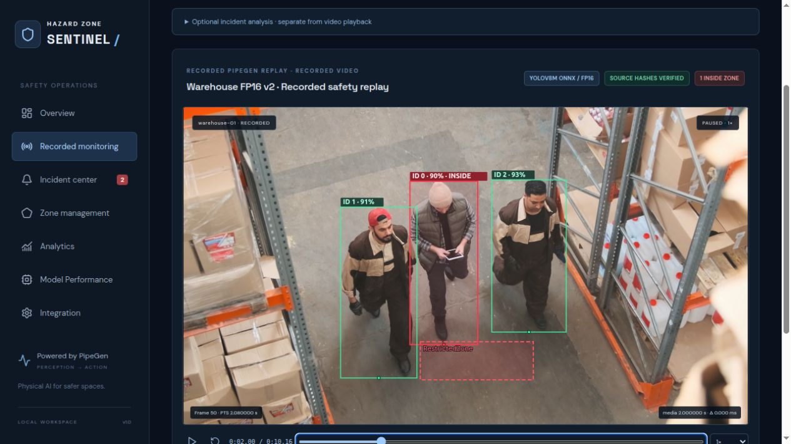
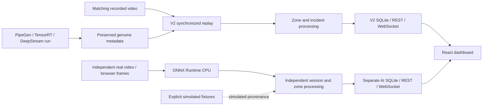

# Hazard Zone Sentinel

**Camera detections become actionable restricted-zone incidents.**

[Public source repository](https://github.com/akilanpl/hazard-zone-sentinel) · [Warehouse evidence](docs/factory-release.md) · [Independent AI guide](docs/independent-ai-monitor.md) · [Submission checklist](docs/submission-checklist.md)

Hazard Zone Sentinel is a local React/TypeScript and FastAPI safety-monitoring prototype. It combines video overlays, editable polygon zones, incident history, acknowledgments, SQLite persistence and WebSocket updates.

Two processing paths are implemented and kept separate:

| Path | Input and perception | Verified scope |
| --- | --- | --- |
| **Warehouse V2 — PipeGen** | Original recorded warehouse video and matching real PipeGen/DeepStream metadata from YOLOv8m TensorRT FP16 | Recorded video/box synchronization, polygon analysis, two persisted entry alerts and restart recovery |
| **Independent AI Camera Monitor** | Actual video pixels through ONNX Runtime CPU; virtual video, browser-selected MP4 and simulated USB stream | Genuine inference, correlated frame overlays, source/session isolation, simulation, browser lifecycle and persistence |

**Physical USB camera hardware: NOT TESTED.** The simulated USB pathway uses prerecorded video through `captureStream()` and real inference; it is not evidence of a connected physical camera. This moving-camera, image-space demonstration is not a calibrated industrial protective system.



## What works

- Person boxes, confidence and reported/estimated track IDs aligned with the displayed source frame.
- Normalized polygon drawing/editing and validated zone configuration.
- Entry/hold/exit/reentry logic, with first-observed-inside distinguished from observed crossings.
- Incident filtering, details, acknowledgment and persistent session history.
- REST/WebSocket updates, reconnect behavior, bounded frame processing and explicit source errors.
- Separate V2 and independent-source databases; replay visualization does not silently append incidents.
- Explicit **SIMULATED TEST DATA** scenarios, distinct from actual model detections.

### Verified warehouse result

The preserved Warehouse V2 run contains **254 frames, 522 person observations and 6 raw tracker IDs**. Application analysis produced **2 observed-entry alerts, including 1 same-track reentry**, **2 observed exits**, **0 first-seen-inside alerts** and **43 suppressed inside holds**. Track IDs are not a count of unique physical people.

All source timestamps were checked with the verified **+80 ms** mapping. Browser frames at 1, 2, 3 and 4 seconds were reviewed against actual boxes and viewport bounds. Native ROI occupancy disagrees with application bottom-center geometry on **9 frames**; the cause remains unresolved. The camera moves and the ROI is a hypothetical frame-relative aisle region. [Detailed audit and limitations](evidence/06-real-metadata/factory-metadata-audit.json).

Historical street footage, its 1,029-frame run and its 33-alert analysis remain preserved as separate fallback evidence; they are not factory results.

## Performance: keep the measurement scopes separate

| Evidence | Result | Scope and limitation |
| --- | --- | --- |
| Factory TensorRT FP16 engine | **188.877 reported QPS**, **5.28244 ms GPU compute**, **6.19475 ms engine end-to-end latency** | Existing PipeGen engine report; not full DeepStream FPS. The report's measured-device field is unidentified |
| Reported factory engine power | **135.222 W**, 66 samples, stated ±5 W | GPU-board power during the engine run, reported from `nvidia-smi`; not whole-system power or independently remeasured here |
| Independent simulated-USB CPU sample | **12 WebSocket frames, 25 person observations; 685.28 ms median processing**, approximately **1.46 reciprocal-median frames/s** | ONNX Runtime CPU JPEG/preprocess/inference/postprocess; not camera throughput, GPU timing or a controlled FP16 comparison |

The factory engine is TensorRT **10.3.0**, **52,792,260 bytes**, with **199 layers: 185 FP16 and 14 FP32**. Exact hashes and measurement fields are in the [factory engine summary](evidence/04-tensorrt-fp16/warehouse-engine-summary.json). Independent inference uses **ONNX Runtime 1.31.0 / CPUExecutionProvider**, YOLOv8m input `[1,3,480,640]`; [browser acceptance evidence](evidence/independent-ai/final-browser-acceptance.json) records the CPU sample.

A shelving false positive was observed near media time 4.24 seconds at confidence approximately 0.54. IoU-based independent IDs are approximate associations; looping test footage does not establish unique people or physical reentry. **No formal precision, recall, F1 or mAP is currently claimed.** Modeled Orin values are not measured Jetson performance.

## Run locally

Use **Python 3.12** for the tested lockfile and **Node 22.18+** for the complete checks (tested Node 24). Install application dependencies on a clean checkout:

```bash
python3.12 -m venv .venv
.venv/bin/python -m pip install -r requirements-lock.txt
cd frontend
npm install
cd ..
```

For lockfile-based pnpm installation, use `pnpm install --frozen-lockfile --store-dir .pnpm-store` in `frontend/` instead of npm. [Setup](docs/setup.md) includes the existing bundled runtime paths for the development host.

The licensed warehouse MP4 and model/runtime binaries are **external assets**, not included in ordinary Git history. The V2 launcher validates the known video/metadata hashes and refuses a mismatched source. From the repository root, use separate terminals:

**1. Warehouse V2 backend, port 8003**

```bash
./scripts/start-warehouse-demo.sh /absolute/path/to/warehouse-workers-4281405-1080p.mp4
```

**2. Optional independent AI backend, port 8005**

```bash
AI_PORT=8005 ./scripts/start-ai-monitor.sh
```

This independent service needs the separately configured ONNX model and CPU runtime. The launcher reads `SENTINEL_AI_HOME` or explicit model/dependency/data paths; its development-host default is `/mnt/seagate4/PipeGenHackathon/independent-ai-monitor`. Missing inference dependencies produce an unavailable state, never fabricated detections. See the [independent setup and protocol](docs/independent-ai-monitor.md).

**3. Frontend, port 5173**

```bash
SENTINEL_API_TARGET=http://127.0.0.1:8003 \
SENTINEL_AI_TARGET=http://127.0.0.1:8005 \
./scripts/start-frontend.sh --port 5173 --strictPort
```

Open **http://127.0.0.1:5173/**. Choose Warehouse V2 for recorded metadata replay or AI Camera Monitor for independent sources. Playback/seek does not create new V2 incidents; **Analyze new session** intentionally creates a separate analysis. A clean checkout has no preexisting SQLite incident history until analysis is requested.

The simulated USB harness is an explicit localhost **development-only** opt-in, `?cameraTest=1`; production defaults leave it disabled. The separately tested development URL was `http://127.0.0.1:5177/?cameraTest=1`. Read the [physical-camera acceptance procedure](docs/camera-hardware-acceptance.md) before claiming hardware readiness has been tested.

Keep this unauthenticated prototype on localhost. Run the storage guard before additional large assets or experiments; preserve at least 1 GiB root and 20 GiB external reserve. No Docker, GPU or PipeGen process is needed merely to replay existing metadata or run the independent CPU module.

## Architecture



PipeGen remains the actual perception source for the hackathon V2 pipeline. The optional CPU worker processes real image pixels independently and never consumes old V2 detections as its inference result. [Architecture](docs/architecture.md) · [Canonical API schema](docs/canonical-schema.md) · [PipeGen handoff](docs/pipegen-handoff.md).

## Verification and evaluation status

The released application checkpoint passed **161 backend tests, 35 frontend tests, TypeScript and production build**. This included three actual-model HTTP/WebSocket source tests, simulated USB discovery/permission/device cleanup, genuine upload, mobile layout, acknowledgment/restart recovery and V2 regression. Physical USB testing remains NOT TESTED. [Executed browser evidence](evidence/independent-ai/final-browser-acceptance.json) · [Restart/isolation evidence](evidence/independent-ai/restart-isolation-verification.json).

```bash
./scripts/check.sh
```

The isolated evaluation audit adds **70 passing fixture checks**: 40 detection-metric cases, 20 alert-robustness cases and 10 human-review gate cases. These validate evaluation software; they are **not measured detector accuracy**. The host completed genuine YOLOv8m CPU inference for all **41 real warehouse frames** (median processing latency **629.744 ms**); **1/41 frames are marked reviewed in the latest available partial export**, so precision, recall, F1 and AP remain PENDING HUMAN REVIEW. Predictions are not ground truth; incomplete review must leave formal metrics unavailable. The user reports completing review, but the available exported file is still PARTIAL; a complete export must be validated before formal metrics. The optional accuracy study is explicitly decoupled from the tested application release.

- [Evaluation tools](evaluation/) and [reproducibility workflow](docs/evaluation/reproducibility.md).
- [Alert robustness fixtures](evidence/evaluation/alert-robustness-tests.json).
- [INT8 feasibility](docs/evaluation/int8-feasibility.md): technically plausible as a separate future candidate, but execution is NO-GO in this read-only audit. No INT8 advantage or completed bonus is claimed.
- **Jetson: NOT DEPLOYED / NOT TESTED. Closed-loop physical board action: NOT TESTED.**

The isolated audit full check actually passed **231 backend tests, 35 frontend tests, TypeScript and production build**. The three existing actual-model HTTP/WebSocket tests ran against the available CPU worker. These totals include the 70 new evaluation fixtures; they do not establish detector accuracy. See the [current audit summary](evidence/evaluation/audit-summary.json).

## Export and hackathon submission

The [factory PipeGen export release](https://github.com/akilanpl/hazard-zone-sentinel/releases/tag/warehouse-fp16-v2-2026-10-18) and its [local audit](evidence/factory-export-audit.json) identify the genuine **134,818,189-byte** archive, SHA-256 `5a2314ab3b97787ec699bb185b767bbf4ab70b7517433988d8e6d9e0c3aa4dec`. The source video is external and its launcher requires `--input`. Historical private-access wording in old evidence records describes that earlier checkpoint; the repository is now **public**. Current release-asset access should still be checked for judges.

The [official problem statement](evidence/01-requirement-and-flow/official-problem-statement.pdf) requires actual PipeGen flow, TensorRT/report evidence, GPU execution and actionable output. **Actual PipeGen IR node-graph and speed-report GUI screenshots remain gaps**; saved IR JSON and application screenshots do not replace them. A venue/live GPU demonstration is distinct from recorded dashboard replay.

The user reports completing prerequisite feedback. The final project-submission link, receipt and judging access remain unconfirmed; **no final submission is claimed**. [Form handoff](docs/submission-form-handoff.md) · [Page-mapped checklist](docs/submission-checklist.md) · [Evidence ledger](evidence/checklist.json). The operative event cutoff selected by the user was **October 18, 2026, 4 PM IST**.

## Source and media credits

`backend/` contains the two services, validation, event processing and persistence; `frontend/` contains the existing React dashboard; `tests/` and `frontend/tests/` hold checks; `evaluation/` adds review-gated offline evaluation; `docs/` and `evidence/` retain scoped provenance. This audit changes documentation/evaluation tooling, not the dashboard's visual design.

Warehouse footage: [Men Working in a Warehouse](https://www.pexels.com/video/men-working-in-a-warehouse-4281405/) by **Tiger Lily / Pexels**, under the [Pexels License](https://www.pexels.com/license/). Historical street footage: [Busy City Intersection with Pedestrians and Traffic](https://www.pexels.com/video/busy-city-intersection-with-pedestrians-and-traffic-36306747/) by **Nothing Ahead / Pexels**. Source media remains external; footage licenses are separate from application source and do not imply endorsement. [Video provenance and recording notes](demo-video/README.md).
