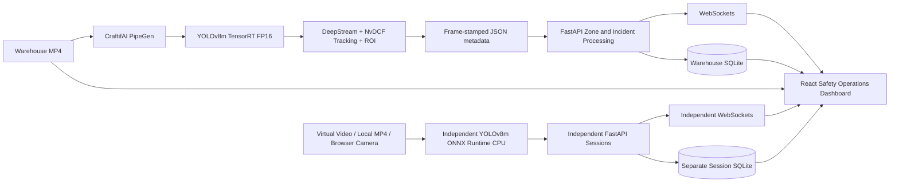

# Hazard Zone Sentinel

**A workplace safety perception system built with CraftifAI PipeGen, NVIDIA TensorRT, DeepStream, FastAPI and React.**

Hazard Zone Sentinel detects people in warehouse footage, tracks their movement, evaluates entry into restricted zones and turns vision metadata into incidents that operators can inspect and acknowledge. The project was built for **Track A — PipeGen (Perception)** of the Embedded SF: CraftifAI Physical AI Hackathon, following the suggested *Workplace Safety Sentinel* use case.

The core demonstration uses an actual PipeGen-generated, GPU-executed warehouse pipeline. Its matching video and DeepStream metadata are replayed in an operations dashboard, where safety-zone decisions, incidents and analytics remain accessible. A separate AI Camera Monitor also processes newly supplied video frames through a CPU inference service.

## Track A: From Requirement to Actionable Output

The hackathon's Track A calls for a complete PipeGen workflow, a TensorRT engine and speed report, execution on an NVIDIA GPU or Jetson, and an output that can drive an operational decision. Hazard Zone Sentinel implements this as follows:

| Track A requirement | Hazard Zone Sentinel implementation | Evidence |
|---|---|---|
| **1. Requirement → Pipeline IR → Model → Compiler → Run** | A seven-node warehouse perception graph: video input, preprocessing, YOLOv8m inference, person postprocessing, NvDCF tracking, restricted-zone analytics and JSON export. | [Saved Pipeline IR](evidence/02-pipeline-ir/README.md) · [Pipeline IR JSON](evidence/02-pipeline-ir/factory-PipelineIR.redacted.json) |
| **2. TensorRT engine and speed report** | YOLOv8m ONNX compiled to a TensorRT 10.3.0 FP16 engine with measured engine latency, throughput and GPU-board power. | [Warehouse compiler report](evidence/04-tensorrt-fp16/warehouse-engine-summary.json) · [Compiler evidence](evidence/04-tensorrt-fp16/README.md) |
| **3. Run the pipeline on NVIDIA hardware** | The DeepStream pipeline processed a genuine warehouse MP4 and produced matching, frame-timestamped person/tracking metadata. The rules explicitly permit video-file input. | [Warehouse output audit](evidence/final-product/warehouse-audit.json) · [Recorded metadata](evidence/06-real-metadata/warehouse-fp16-v2-metadata.json) |
| **4. Actionable output beyond bounding boxes** | JSON detections and tracking metadata feed polygon-based zone events, SQLite incident history, WebSocket updates, analytics, review actions and JSON export. | [Warehouse verification](evidence/07-real-mode-dashboard/warehouse-browser-alignment.json) · [Integration API contract](docs/canonical-schema.md) |

**PipeGen supplies the core warehouse perception pipeline.** The dashboard consumes the genuine DeepStream output from that pipeline; recorded playback is not presented as a fresh live GPU run.

The complete [Warehouse FP16 v2 PipeGen export](https://github.com/akilanpl/hazard-zone-sentinel/releases/tag/warehouse-fp16-v2-2026-10-18) is distributed as a GitHub Release asset, including the saved pipeline and engine artifacts.

## Recorded Warehouse Demonstration

The warehouse processing run generated:

| Observation | Verified result |
|---|---:|
| Processed frames | **254** |
| Person observations | **522** |
| Observed tracking IDs | **6** |
| Persisted restricted-zone entry incidents | **2**, including one re-entry |
| Observed exits | **2** |

In the dashboard, the recorded video is synchronized to the source PTS timestamps. Workers are shown with person detections and track IDs; the restricted-zone polygon follows normalized frame coordinates. Operators can inspect incident details, filter history, acknowledge events and export JSON without replay controls creating duplicate incidents.

The source footage contains camera motion, so its polygon represents a **frame-relative demonstration zone**, rather than a calibrated fixed floor boundary. Person observations refer to detections across frames, not unique individuals.

## Capabilities

- **Recorded Monitoring:** synchronized warehouse MP4, genuine detection boxes, NvDCF track IDs, confidence values and a restricted-zone overlay.
- **Incident Center:** persistent SQLite event history, severity/zone/event filters, details, acknowledgment state and JSON export.
- **Zone Management:** application-managed polygon creation and editing, validation, severity and confidence settings.
- **Analytics:** incident trends, severity breakdowns, incidents by zone and acknowledgment summaries derived from stored events.
- **Model Performance:** clearly separated warehouse TensorRT engine evidence, historical engine results and independent CPU measurements.
- **AI Camera Monitor:** real YOLOv8m CPU detections from a warehouse virtual camera and locally selected MP4 files, with independent sessions and incident storage.
- **USB / webcam interface:** browser camera discovery, explicit user permission, source selection, frame capture, start/stop controls, disconnect handling and stream cleanup. The simulated USB harness exercises the same capture/inference pathway with real prerecorded image pixels; physical USB hardware validation is separate from this simulation.
- **Safety simulation:** a deterministic, nine-step zone scenario with **two entries, two exits and one re-entry**, separately labeled as synthetic business-logic test data.
- **Integration:** FastAPI detection ingestion, WebSocket updates and health/status reporting for the main pipeline and independent inference service.

## Architecture



The warehouse replay and the independent AI monitor use different inference paths and separate incident databases. Synthetic test detections are visibly labeled and never substituted for genuine model predictions.

## Dashboard

Eight integrated pages cover the monitoring workflow, incident response and pipeline evidence.

| Overview | Recorded Monitoring |
|---|---|
|  |  |

| Incident Center | Analytics |
|---|---|
|  |  |

| Zone Management | Model Performance |
|---|---|
|  |  |

| AI Camera Monitor | Integration |
|---|---|
|  |  |

## TensorRT and Inference Evidence

| Measurement | Result | Scope |
|---|---|---|
| Model | YOLOv8m ONNX → TensorRT 10.3.0 FP16 | 199 engine layers (185 FP16, 14 FP32) |
| GPU compute time | **5.28244 ms** | Warehouse engine benchmark |
| End-to-end engine time | **6.19475 ms** | Engine execution |
| Reported throughput | **188.877 inferences/s** | PipeGen engine benchmark; not full-pipeline FPS |
| Reported GPU-board power | **135.222 W** | `nvidia-smi` readings during engine execution, 66 samples; reported accuracy ±5 W |
| FP16 engine size | **52,792,260 bytes** | Exported engine artifact |
| Independent CPU processing | **629.744 ms median**, 41 frames | Separate ONNX Runtime CPU sample |

These results distinguish model-engine measurements from video playback, full application latency and independent CPU processing. The benchmark report does not identify the GPU device; reported GPU-board power is not whole-system power and was not independently remeasured. Engine timings do not establish full-pipeline FPS or camera-to-alert latency. The CPU sample measures processing time, not independent detection accuracy. Sources: [warehouse benchmark report](evidence/04-tensorrt-fp16/warehouse-engine-summary.json), [CPU audit](evidence/evaluation/audit-summary.json) and [historical engine report](evidence/04-tensorrt-fp16/measured-engine-summary.json).

## Run the Application

The verified application environment uses Python 3.12 and Node.js 24. Node.js 22.18+ supports the native TypeScript regression suite. The warehouse video, model binaries and optional CPU dependencies are stored outside Git. Independent inference uses ONNX Runtime 1.31.0, NumPy 2.5.4 and Pillow 13.0.0. Camera access requires localhost or HTTPS and user permission; simulated USB capture requires browser video `captureStream()` support.

Install application dependencies from the repository root:

```bash
python3 -m venv .venv
.venv/bin/python -m pip install -r requirements-lock.txt
cd frontend
npm install
cd ..
```

Use `pnpm install --frozen-lockfile` instead of `npm install` for the checked-in frontend lockfile. See [application setup](docs/setup.md) for configuration and compatible Python requirements.

Start the following services from separate terminals:

```bash
# Warehouse V2 replay API — port 8003
./scripts/start-warehouse-demo.sh /absolute/path/to/warehouse-workers-4281405-1080p.mp4
```

```bash
# Independent CPU AI service — port 8005
SENTINEL_AI_HOME=/absolute/path/to/independent-ai-monitor \
AI_PORT=8005 ./scripts/start-ai-monitor.sh
```

```bash
# React dashboard — port 5173
SENTINEL_API_TARGET=http://127.0.0.1:8003 \
SENTINEL_AI_TARGET=http://127.0.0.1:8005 \
./scripts/start-frontend.sh --port 5173 --strictPort
```

Open **http://127.0.0.1:5173/**. The independent service is optional for warehouse replay. A clean clone excludes incident databases; the preserved demonstration environment contains the two recorded warehouse incidents.

To demonstrate the monitoring features, start with Recorded Monitoring and review the matching incidents, then visit AI Camera Monitor for real CPU inference from a virtual camera or local video. The browser camera flow requires user authorization; the development-only simulated USB harness is available through the `?cameraTest=1` query parameter on localhost. See [camera monitor setup and controls](docs/independent-ai-monitor.md).

## Verification

The integrated application passed **239 backend tests**, **89 frontend tests**, TypeScript checks and a production build. Browser acceptance covered all eight pages at desktop, laptop and mobile sizes, including playback alignment, incident review and persistence, polygon editing, genuine CPU inference, MP4 upload and the simulated USB camera lifecycle.

```bash
bash scripts/check.sh
```

For actual-worker HTTP/WebSocket tests, run the independent inference service and provide real review frames and compatible local model paths; see [test setup](docs/independent-ai-monitor.md).

[Executed test results](evidence/final-product/tests.txt) · [Browser acceptance matrix](evidence/final-product/matrix.md) · [Post-integration verification](evidence/final-product/postmerge-acceptance.json)

Actual-worker tests are skipped without their opt-in environment. Browser zone and acknowledgment mutations use an isolated test database.

## Source, Export and Reproducibility

- [Full PipeGen export archive](https://github.com/akilanpl/hazard-zone-sentinel/releases/tag/warehouse-fp16-v2-2026-10-18) · [Export integrity audit](evidence/factory-export-audit.json)
- [Pipeline IR](evidence/02-pipeline-ir/README.md) · [TensorRT evidence](evidence/04-tensorrt-fp16/warehouse-engine-summary.json) · [Warehouse DeepStream output audit](evidence/final-product/warehouse-audit.json)
- [Recorded warehouse metadata](evidence/06-real-metadata/warehouse-fp16-v2-metadata.json) · [Video synchronization evidence](evidence/07-real-mode-dashboard/warehouse-browser-alignment.json)
- [Canonical detection API](docs/canonical-schema.md) · [Native metadata integration](docs/pipegen-handoff.md) · [Application setup](docs/setup.md)

The exported archive is **134,818,189 bytes**, with SHA-256 `5a2314ab3b97787ec699bb185b767bbf4ab70b7517433988d8e6d9e0c3aa4dec`. Large media and inference artifacts are distributed separately from ordinary Git history.

Warehouse footage: [Men Working in a Warehouse](https://www.pexels.com/video/men-working-in-a-warehouse-4281405/) by Tiger Lily / Pexels, under the [Pexels License](https://www.pexels.com/license/). Historical street footage attribution is retained in [media provenance](demo-video/README.md). Media licenses are separate from application source and do not imply endorsement.
