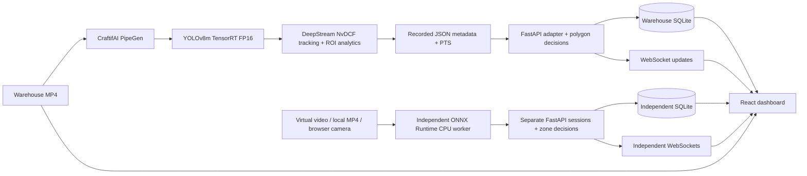

# Hazard Zone Sentinel

**Warehouse perception, restricted-zone awareness and reviewable safety incidents.**

Hazard Zone Sentinel connects a CraftifAI PipeGen warehouse perception pipeline to a React operations dashboard. YOLOv8m TensorRT FP16 detections, DeepStream NvDCF tracking and recorded ROI metadata become synchronized video overlays, polygon-based events and persistent incident history.

The Warehouse FP16 v2 demonstration contains **254 frames, 522 person observations, six track IDs and two recorded warehouse entry incidents**, with two observed exits. The independent AI Camera Monitor processes new video frames with ONNX Runtime on the CPU and keeps its sessions separate from the warehouse recording.

## Capabilities

- **Synchronized warehouse replay:** actual MP4 footage with PTS-aligned person boxes, confidence, track IDs, restricted-zone overlays, playback controls and seeking.
- **Restricted-zone decisions:** normalized polygon editing and configurable confidence/debounce rules; entry, hold, exit and re-entry evaluation using each person’s bottom-center position. The moving-camera recording uses a screen-relative demonstration region.
- **Incident operations:** SQLite history, severity/zone/event filters, event details, persistent acknowledgments and JSON export. Playback and seeking do not create incidents.
- **Analytics and zone management:** daily and Monday-starting UTC weekly trends, severity and zone distributions, acknowledgment summaries, validated zone creation/editing and confirmed deletion.
- **Independent CPU AI:** warehouse virtual camera, local MP4 upload and a permission-based browser camera interface with device selection, disconnect handling and resource cleanup. Captured frames are displayed with their matching inference results, separately from the advancing source preview.
- **Simulation workflows:** a simulated USB adapter uses prerecorded video pixels to exercise camera capture and inference; a separate deterministic nine-step scenario validates two entries, two exits and one re-entry. Simulation is explicitly labeled and isolated from real-data sessions.
- **Integration and model evidence:** separate API/WebSocket/AI-service health, copyable ingestion endpoints, source provenance and distinct warehouse, historical engine and CPU measurements.

## Architecture



The warehouse dashboard replays a genuine PipeGen execution; it does not rerun GPU inference. Independent CPU inference consumes captured image pixels rather than prerecorded boxes. Application-managed zone rules remain separate from the exported DeepStream configuration.

## Screenshots

Actual rendered application views; media and evidence remain distinct from illustrative simulation.

| Overview | Recorded Monitoring |
|---|---|
|  |  |

| Incident Center | Analytics |
|---|---|
|  |  |

| Zone Management | Model Performance |
|---|---|
|  |  |

| AI Camera Monitor | Integration |
|---|---|
|  |  |

## Measured Performance

| Measurement | Result | Scope |
|---|---|---|
| Warehouse model | YOLOv8m ONNX → TensorRT 10.3.0 FP16 | 199 compiled layers: 185 FP16 + 14 FP32 |
| GPU compute time | **5.28244 ms** | Engine benchmark |
| End-to-end engine time | **6.19475 ms** | Engine run, excluding the complete application pipeline |
| Reported throughput | **188.877 inferences/s** | Engine benchmark field; not video FPS or camera-to-alert throughput |
| Reported GPU-board power | **135.222 W** | 66 nvidia-smi samples during engine execution; reported accuracy ±5 W |
| FP16 engine size | **52,792,260 bytes** | Hash-verified exported engine |
| Independent CPU processing | **629.744 ms median**, 41 frames | Stored ONNX Runtime CPU audit; separate from TensorRT measurements |

The engine report does not identify its GPU device. GPU-board power is not whole-system power; engine timings do not establish full-pipeline FPS or camera-to-alert latency. Replay playback speed is not an inference benchmark. The CPU audit reports processing time, not independent detection accuracy.

Sources: [warehouse engine summary](evidence/04-tensorrt-fp16/warehouse-engine-summary.json) · [historical engine summary](evidence/04-tensorrt-fp16/measured-engine-summary.json) · [CPU audit](evidence/evaluation/audit-summary.json) · [CPU inference sample](evidence/independent-ai/cpu-runtime-validation.json).

## Getting Started

### Requirements and installation

- Python 3.10+; the tested environment uses Python 3.12.
- Node.js 22.18+ for the native TypeScript test suite; the tested environment uses Node 24.
- A modern browser. Camera access requires localhost or HTTPS and user permission; the simulated USB adapter requires video `captureStream()` support.
- The matching warehouse MP4, stored outside Git. The launcher validates video and metadata hashes.
- For independent inference: a compatible YOLOv8m ONNX model and the external CPU runtime: ONNX Runtime 1.31.0, NumPy 2.5.4 and Pillow 13.0.0.

```bash
python3 -m venv .venv
.venv/bin/python -m pip install -r requirements-lock.txt
cd frontend
npm install
cd ..
```

Use `pnpm install --frozen-lockfile` instead of `npm install` for the checked-in frontend lockfile. For Python environments incompatible with the Python 3.12 lock, use `requirements.txt`. Application setup does not require Docker, GPU drivers or PipeGen changes. See [detailed setup](docs/setup.md) and [independent runtime setup](docs/independent-ai-monitor.md).

### Launch

From the repository root, run each service in a separate terminal:

```bash
# Warehouse replay API — port 8003
./scripts/start-warehouse-demo.sh /absolute/path/to/warehouse-workers-4281405-1080p.mp4
```

```bash
# Independent CPU AI API — port 8005
SENTINEL_AI_HOME=/absolute/path/to/independent-ai-monitor \
AI_PORT=8005 ./scripts/start-ai-monitor.sh
```

```bash
# React dashboard — port 5173
SENTINEL_API_TARGET=http://127.0.0.1:8003 \
SENTINEL_AI_TARGET=http://127.0.0.1:8005 \
./scripts/start-frontend.sh --port 5173 --strictPort
```

Open **http://127.0.0.1:5173/**. The independent service is optional for warehouse replay. Its external home contains `models/`, `dependencies/` and `sessions/`; keep independent session storage separate from the warehouse database. A clean clone excludes incident databases; the preserved demonstration environment contains the two recorded warehouse incidents.

### Explore the demonstration

1. **Recorded Monitoring:** play or seek the warehouse video and inspect synchronized detections and the red zone.
2. **Incident Center / Analytics:** review stored entries, acknowledge events, export JSON and compare persisted totals.
3. **Zone Management:** select a zone to edit its polygon and rules, then save or cancel.
4. **AI Camera Monitor:** choose virtual video or a local MP4, start a session and inspect actual captured-frame CPU detections. The browser camera interface provides permission-based device connection.
5. **Simulation:** run the labeled safety scenario. For the simulated USB workflow, use localhost development mode with `?cameraTest=1`; it exercises an app-owned prerecorded-video adapter, not physical USB hardware.

Use **Stop & release** to end sampling and free capture resources. CPU track associations are estimates rather than verified physical identities. [Camera protocol and lifecycle guide](docs/independent-ai-monitor.md).

## API and Integration

FastAPI provides zone configuration, incident review/acknowledgment/export, analytics and WebSocket updates. In live ingestion mode, `POST /api/ingest/detections` accepts canonical normalized person detections; `POST /api/ingest/pipegen` requires a parser configured against genuine native metadata. Replay and synthetic modes reject external real-data ingestion. The independent service exposes its own session/frame API and WebSocket channel.

[Canonical detection contract](docs/canonical-schema.md) · [Native metadata handoff](docs/pipegen-handoff.md) · [API configuration](docs/setup.md).

## Verification

**239 backend tests and 89 frontend tests passed**, including genuine CPU-worker HTTP/WebSocket integration checks. TypeScript validation and the production build passed. Browser verification covered all eight pages at 1600×900, 1920×1080, 1366×768 and 390×844, including replay alignment, real CPU video inference, simulated USB lifecycle, upload, session isolation and incident/zone operations against isolated test data.

```bash
bash scripts/check.sh
```

To include actual-worker tests, start the independent service and supply locally prepared review JPEGs:

```bash
SENTINEL_AI_E2E_URL=http://127.0.0.1:8005/api/ai \
SENTINEL_AI_E2E_FRAMES=/absolute/path/to/review-jpegs \
SENTINEL_AI_MODEL_PATH=/absolute/path/to/yolov8m.onnx \
SENTINEL_AI_DEPENDENCIES_PATH=/absolute/path/to/cpu-dependencies \
bash scripts/check.sh
```

Without this opt-in configuration, actual-worker tests are skipped. [Test results](evidence/final-product/tests.txt) · [Browser acceptance matrix](evidence/final-product/matrix.md) · [Post-integration verification](evidence/final-product/postmerge-acceptance.json).

## PipeGen Export and Technical Evidence

- [Warehouse FP16 v2 PipeGen export](https://github.com/akilanpl/hazard-zone-sentinel/releases/tag/warehouse-fp16-v2-2026-10-18): **134,818,189-byte** release archive; SHA-256 `5a2314ab3b97787ec699bb185b767bbf4ab70b7517433988d8e6d9e0c3aa4dec`.
- [Export integrity audit](evidence/factory-export-audit.json) · [Pipeline IR](evidence/02-pipeline-ir/README.md) · [Model/compiler evidence](evidence/04-tensorrt-fp16/README.md) · [DeepStream execution](evidence/05-deepstream-run/README.md).
- [Genuine warehouse metadata](evidence/06-real-metadata/warehouse-fp16-v2-metadata.json) · [Video/overlay alignment](evidence/07-real-mode-dashboard/warehouse-browser-alignment.json) · [Warehouse profile](examples/warehouse-profile.json).

Large videos, models, runtime environments, credentials and incident databases are excluded from ordinary Git. The export is distributed as a GitHub Release asset; its source video is an external licensed input.

## Media Attribution

Warehouse footage: [Men Working in a Warehouse](https://www.pexels.com/video/men-working-in-a-warehouse-4281405/) by Tiger Lily / Pexels, under the [Pexels License](https://www.pexels.com/license/). Historical street footage attribution is retained in [media provenance](demo-video/README.md). Media licensing is separate from application source and does not imply endorsement.
