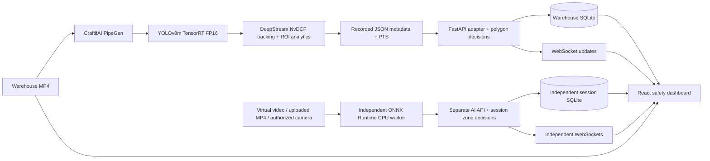

# Hazard Zone Sentinel

A safety operations dashboard that turns PipeGen person detections into visible restricted-zone activity and reviewable incidents.

## Overview

Factory operators need to see where people enter restricted areas and retain enough context to review each event. Hazard Zone Sentinel combines a genuine CraftifAI PipeGen warehouse execution with synchronized video, tracked detections, configurable polygons, incident history and analytics.

The core demonstration replays the original Warehouse FP16 v2 video and its matching DeepStream metadata. An independent AI Camera Monitor processes new recorded-video or camera pixels with ONNX Runtime on the CPU, using separate sessions and incident storage.

## Key Capabilities

- **PipeGen warehouse replay:** matching MP4 and genuine YOLOv8m TensorRT FP16 detections, NvDCF track IDs, confidence and PTS-aligned overlays.
- **Restricted-zone analysis:** normalized polygons, bottom-center person membership, entry/hold/exit/re-entry evaluation, configurable confidence and debounce rules.
- **Incident review:** SQLite history, severity/zone/event filters, JSON export, details and persistent acknowledgments.
- **Safety analytics:** stored incident totals, daily or Monday-starting UTC weekly trends, severity/zone distributions and acknowledgment summaries.
- **Model evidence:** separate warehouse engine, historical engine and independent CPU measurements, with source JSON and explicit measurement boundaries.
- **Independent AI Camera Monitor:** genuine CPU inference from warehouse virtual video, locally selected MP4 files and an explicit simulated USB capture harness; deterministic simulation remains clearly labeled.
- **USB camera interface:** device selection, explicit permission/connection, disconnect handling and media-track cleanup. Physical USB hardware acceptance remains untested.
- **Integration visibility:** primary API, WebSocket and independent-service health are distinguished; endpoint contracts and source provenance are visible.

The verified warehouse recording contains **254 frames, 522 person observations and six tracker IDs**. The preserved demonstration database contains **two computed entry incidents**; analysis also observed two exits. Observations are not unique people. A clean clone has no bundled incident database.

## System Architecture



PipeGen supplies the core warehouse model, tracking and recorded inference evidence. The browser replays that execution; it does not rerun a GPU engine. Independent CPU processing uses captured image pixels, not prerecorded PipeGen boxes. Simulation fixtures are labeled and isolated from both real-data paths.

## Screenshots

Actual rendered application views; media and evidence remain distinct from illustrative simulation.

| Overview | Recorded Monitoring |
|---|---|
|  |  |

| Incident Center | Analytics |
|---|---|
|  |  |

| Zone Management | Model Performance |
|---|---|
|  |  |

| AI Camera Monitor | Integration |
|---|---|
|  |  |

## Demonstration

1. Open **http://127.0.0.1:5173/** and use Recorded Monitoring to play, pause or seek the verified warehouse recording. Boxes, track IDs and the red polygon follow the selected recorded frame.
2. Review the stored events in Incident Center and compare them with Analytics. Video playback and seeking do not create incidents. Optional **Analyze new session** explicitly starts another persisted metadata analysis.
3. In AI Camera Monitor, check the independent service and choose Warehouse Virtual Camera or Upload MP4. Start monitoring to inspect captured pixels with their matching inference result. The source preview intentionally has no detection overlay.
4. Use Simulation for the labeled nine-step safety-logic scenario: two entries, two exits and one re-entry. Stop & release closes sampling and capture resources.

The simulated USB harness is available only on localhost in development with `?cameraTest=1`; it uses real prerecorded video pixels through an app-owned camera adapter. It does not validate physical camera hardware. See the [camera protocol and lifecycle guide](docs/independent-ai-monitor.md).

## Performance

| Evidence | Result | Measurement scope |
|---|---|---|
| Warehouse FP16 engine | YOLOv8m ONNX, TensorRT 10.3.0, 199 layers | 185 FP16 +14 FP32 layers; semantic model version not reported |
| GPU compute | **5.28244 ms** | Model engine benchmark |
| End-to-end engine | **6.19475 ms** | Engine run; excludes the complete application pipeline |
| Reported engine throughput | **188.877 inferences/s** | Reported benchmark field; not video FPS or camera-to-alert throughput |
| Reported GPU-board power | **135.222 W**, 66 samples, reported accuracy **±5 W** | nvidia-smi during engine run; not independently remeasured or whole-system power |
| Engine size | **52,792,260 bytes** | Exported FP16 engine hash verified |
| Recorded DeepStream output | **254 frames / 522 person observations / 6 tracker IDs** | Genuine recorded execution output; replay speed is not inference performance |
| Independent CPU audit | **629.744 ms median** across 41 frames | Stored ONNX Runtime CPU processing sample; not a TensorRT or complete-pipeline benchmark |
| Complete pipeline FPS / camera-to-alert latency | **Not measured** | No value inferred from engine timing or replay speed |

The measured GPU device is unidentified in the report. Modeled Orin NX estimates do not establish a Jetson deployment. Historical engine measurements remain separately labeled on Model Performance.

Sources: [warehouse engine summary](evidence/04-tensorrt-fp16/warehouse-engine-summary.json), [historical engine summary](evidence/04-tensorrt-fp16/measured-engine-summary.json), [CPU audit](evidence/evaluation/audit-summary.json), [CPU processing sample](evidence/independent-ai/cpu-runtime-validation.json).

## Getting Started

### Requirements

- Python 3.10+ for the application; the verified environment uses Python 3.12.
- Node.js 22.18+ for the complete native TypeScript regression suite; the verified environment uses Node 24. React/Vite dependencies are in `frontend/package.json` and `frontend/pnpm-lock.yaml`.
- A modern browser. Camera access requires localhost or HTTPS and explicit user permission. The simulated USB harness also requires browser video `captureStream()` support.
- The matching licensed warehouse MP4, stored outside Git. The launcher validates the source video and metadata hashes.
- For independent inference: a compatible YOLOv8m ONNX model, ONNX Runtime CPU 1.31.0, NumPy 2.5.4 and Pillow 13.0.0. These optional runtime/model files are external; missing dependencies produce an unavailable state.

Application setup does not require Docker, GPU drivers or changes to PipeGen. Keep large media/models and optional dependencies on storage with sufficient capacity.

### Install application dependencies

On a clean checkout, create a virtual environment and install the tested Python requirements:

```bash
python3 -m venv .venv
.venv/bin/python -m pip install -r requirements-lock.txt
cd frontend
npm install
cd ..
```

For a reproducible frontend installation with pnpm, use `pnpm install --frozen-lockfile` instead of `npm install`. Use `requirements.txt` if the Python 3.12 lock is incompatible with another supported environment. Reuse an existing compatible environment when available. [Detailed setup](docs/setup.md).

### Start the warehouse demonstration

Run these from the repository root in separate terminals:

```bash
# Warehouse V2 API, port 8003
./scripts/start-warehouse-demo.sh /absolute/path/to/warehouse-workers-4281405-1080p.mp4

# Optional independent AI API, port 8005
SENTINEL_AI_HOME=/absolute/path/to/independent-ai-monitor \
AI_PORT=8005 ./scripts/start-ai-monitor.sh

# React frontend, port 5173
SENTINEL_API_TARGET=http://127.0.0.1:8003 \
SENTINEL_AI_TARGET=http://127.0.0.1:8005 \
./scripts/start-frontend.sh --port 5173 --strictPort
```

Open **http://127.0.0.1:5173/**. If the services are already running, reuse them. The independent AI service is optional; its absence does not prevent Warehouse V2 replay.

### Configuration

| Variable | Purpose |
|---|---|
| `SENTINEL_WAREHOUSE_VIDEO` | Matching external MP4; the warehouse launcher also accepts its path as the first argument |
| `SENTINEL_PROFILE_PATH` | Validated dataset manifest for the generic factory replay launcher |
| `PORT` / `AI_PORT` | API listener ports; warehouse helper defaults to 8003, independent service defaults to 8004 unless overridden |
| `SENTINEL_API_TARGET` / `SENTINEL_AI_TARGET` | Frontend API/WebSocket proxy destinations; launch examples use 8003 /8005 |
| `SENTINEL_AI_HOME` | External independent runtime root containing `models/`, `dependencies/` and `sessions/` |
| `SENTINEL_AI_MODEL_PATH` | Explicit compatible ONNX model path |
| `SENTINEL_AI_DEPENDENCIES_PATH` | Optional existing CPU dependency directory |
| `SENTINEL_AI_DATA_DIR` | Independent session storage; never point it at the warehouse database |

The setup script `scripts/setup-independent-ai-host.sh` prepares optional dependencies only after its host storage guard passes. Inspect its paths before running it. No automatic model download or GPU fallback occurs. [Independent runtime setup](docs/independent-ai-monitor.md).

### Synthetic backend and external ingestion

For a separate synthetic backend, use `SENTINEL_MODE=synthetic PORT=8000 ./scripts/start-backend.sh` and point the frontend's primary API target at port8000. Keep its database separate from Warehouse V2.

In live ingestion mode, `POST /api/ingest/detections` accepts canonical normalized person detections. `POST /api/ingest/pipegen` requires a configured native-schema parser. Replay and synthetic modes reject external real-data ingestion. The independent AI service has its own session/frame API. [Canonical detection contract](docs/canonical-schema.md) · [API setup](docs/setup.md).

## Verification

**239 backend tests and 89 frontend tests passed**, with the genuine CPU-worker integration tests enabled. TypeScript validation and the production build passed. Browser acceptance covered all eight pages at desktop, laptop and mobile sizes. Two nonblocking dependency/OpenAPI warnings are recorded in the test log. The combined regression runs backend tests, frontend tests, TypeScript and production build:

```bash
bash scripts/check.sh
```

Genuine CPU-worker HTTP/WebSocket source tests are opt-in and require the running independent service plus locally prepared review JPEGs:

```bash
SENTINEL_AI_E2E_URL=http://127.0.0.1:8005/api/ai \
SENTINEL_AI_E2E_FRAMES=/absolute/path/to/review-jpegs \
SENTINEL_AI_MODEL_PATH=/absolute/path/to/yolov8m.onnx \
SENTINEL_AI_DEPENDENCIES_PATH=/absolute/path/to/cpu-dependencies \
bash scripts/check.sh
```

Without the opt-in environment, actual-worker tests are reported as skipped; fixture tests are not presented as real inference. Browser CRUD and acknowledgment mutation checks use an isolated copy of the incident database. [Final acceptance](evidence/final-product/acceptance.json) · [Executed tests](evidence/final-product/tests.txt).

## Project Structure

| Directory | Contents |
|---|---|
| `backend/` | Warehouse API, adapters, polygon/event logic, SQLite and independent CPU/session service |
| `frontend/` | React dashboard, synchronized replay, camera lifecycle and responsive workspace |
| `tests/`, `frontend/tests/` | API, persistence, inference, lifecycle, geometry and presentation regressions |
| `config/`, `examples/` | Dataset profiles and canonical metadata examples |
| `scripts/` | Launchers, validation and bounded verification tools |
| `evaluation/` | Human-review workflow and gated offline evaluation |
| `docs/`, `evidence/` | Contracts, setup, model/compiler provenance and executed verification |

## Evidence and Reproducibility

- [PipeGen Warehouse V2 export](https://github.com/akilanpl/hazard-zone-sentinel/releases/tag/warehouse-fp16-v2-2026-10-18): 134,818,189-byte archive, SHA-256 `5a2314ab3b97787ec699bb185b767bbf4ab70b7517433988d8e6d9e0c3aa4dec`.
- [Export integrity audit](evidence/factory-export-audit.json), [Pipeline IR evidence](evidence/02-pipeline-ir/README.md), [model/compiler evidence](evidence/04-tensorrt-fp16/README.md), [DeepStream execution evidence](evidence/05-deepstream-run/README.md).
- [Genuine warehouse metadata](evidence/06-real-metadata/warehouse-fp16-v2-metadata.json), [video/overlay alignment](evidence/07-real-mode-dashboard/warehouse-browser-alignment.json), [dataset profile example](examples/warehouse-profile.json).
- [Independent inference protocol](docs/independent-ai-monitor.md), [evaluation and review artifacts](evidence/evaluation/audit-summary.json), [evidence checklist](evidence/checklist.json).

Videos, model binaries, runtime environments, secrets and incident databases are excluded from ordinary Git history. Use the release archive and its input wrapper for the exported pipeline; source video remains an external licensed input.

Warehouse footage: [Men Working in a Warehouse](https://www.pexels.com/video/men-working-in-a-warehouse-4281405/) by Tiger Lily /Pexels, under the [Pexels License](https://www.pexels.com/license/). Historical street evidence uses [Busy City Intersection with Pedestrians and Traffic](https://www.pexels.com/video/busy-city-intersection-with-pedestrians-and-traffic-36306747/) by Nothing Ahead /Pexels. Footage licenses are separate from application source and do not imply endorsement. [Media provenance](demo-video/README.md).

## Limitations

- Warehouse V2 is a recorded demonstration with a moving camera. Its polygon is a frame-relative region, not a calibrated physical safety boundary.
- Independent CPU processing is slower than the source video rate; approximate track associations do not establish physical identity.
- Physical USB hardware has not been tested. Simulated camera lifecycle tests do not replace hardware acceptance.
- Formal independent person-detection accuracy is **PENDING HUMAN REVIEW**. Predictions and partial annotation exports are not ground truth.
- INT8 execution, Jetson deployment and FirmGen closed-loop hardware are **NOT TESTED**. Full-pipeline FPS, camera-to-alert latency and whole-system power are not measured.
- This is a demonstrator, not a certified industrial safety system. No safety certification or security standard compliance is claimed.
