# Hazard Zone Sentinel

**From warehouse perception to actionable safety events.**

Hazard Zone Sentinel transforms warehouse video into actionable safety intelligence. It detects and tracks workers, evaluates restricted-zone activity and delivers structured incidents to an operations dashboard for review, acknowledgment and analysis.

Built for **Track A — PipeGen (Perception)** of the **Embedded SF: CraftifAI Physical AI Hackathon**, the project brings together a complete PipeGen pipeline, a compiled TensorRT engine, an NVIDIA DeepStream execution and downstream safety operations. It also includes an independent AI Camera Monitor for browser-connected cameras and new video sources.

## Built for CraftifAI Track A

The [official problem statement](evidence/01-requirement-and-flow/official-problem-statement.pdf) requires all five PipeGen stages, a TensorRT engine and speed report, an NVIDIA hardware run, and actionable output. PipeGen is the core perception engine: its generated DeepStream pipeline supplies the genuine detections and tracking metadata used by the warehouse dashboard.

| Mandatory requirement | Actual implementation | Evidence |
|---|---|---|
| **Full PipeGen flow** | Requirement → Pipeline IR → Model → Compiler → Run, completed for the seven-node Warehouse FP16 v2 pipeline. | [Requirement checkpoint](evidence/01-requirement-and-flow/factory-checkpoint-manifest.json) · [Pipeline IR](evidence/02-pipeline-ir/factory-PipelineIR.redacted.json) · [Full export](https://github.com/akilanpl/CraftifAIHackathon_CRA004/releases/tag/warehouse-fp16-v2-2026-10-18) |
| **TensorRT engine and speed report** | YOLOv8m ONNX compiled in PipeGen to TensorRT 10.3.0 FP16, with retained compiler and engine measurements. | [Engine benchmark](evidence/04-tensorrt-fp16/warehouse-engine-summary.json) · [Compiler evidence](evidence/04-tensorrt-fp16/README.md) |
| **Run on NVIDIA hardware** | The generated DeepStream pipeline processed a warehouse MP4 on an NVIDIA GPU machine. The official rules permit video-file input. | [Warehouse audit](evidence/final-product/warehouse-audit.json) · [Recorded DeepStream metadata](evidence/06-real-metadata/warehouse-fp16-v2-metadata.json) |
| **Actionable output** | Structured JSON feeds restricted-zone decisions, persistent incidents, acknowledgment, analytics and WebSocket updates. | [Dashboard alignment and incidents](evidence/07-real-mode-dashboard/warehouse-browser-alignment.json) · [Acceptance matrix](evidence/final-product/matrix.md) · [API contract](docs/canonical-schema.md) |

## Original PipeGen Pipeline Evidence

The following are screenshots captured from the original **Hazard Zone Sentinel — Warehouse FP16 v2** project in CraftifAI PipeGen v0.5.1. They document the actual Pipeline IR, TensorRT compiler benchmark, and completed DeepStream pipeline run. Select an image to open the original full-screen capture.

### 1. Pipeline IR — seven-node graph

[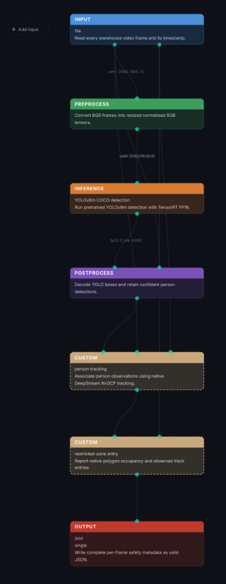](evidence/pipegen-gui/warehouse-ir-graph-original.png)

The seven nodes connect **warehouse video → preprocessing → YOLOv8m inference → postprocessing → NvDCF tracking → restricted-zone analytics → JSON output**. The [saved Pipeline IR](evidence/02-pipeline-ir/factory-PipelineIR.redacted.json) preserves its configuration.

### 2. TensorRT FP16 model speed report

[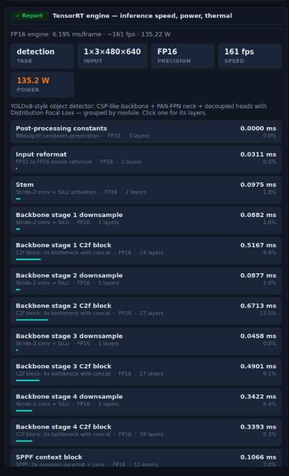](evidence/pipegen-gui/warehouse-fp16-benchmark-original.png)

PipeGen's on-screen benchmark presents approximately **6.195 ms per engine execution** and **135.2 W GPU-board power**. The [engine report JSON](evidence/04-tensorrt-fp16/warehouse-engine-summary.json) separately records **188.877 engine inferences/s**; both figures refer to engine benchmarks rather than full video-pipeline FPS.

### 3. DeepStream pipeline run and export

[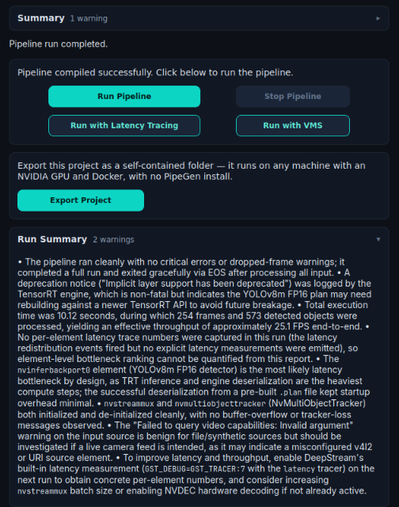](evidence/pipegen-gui/warehouse-deepstream-run-original.png)

The original PipeGen run reports **254 processed frames in 10.12 seconds** and **573 detected objects** across classes. The [warehouse metadata audit](evidence/final-product/warehouse-audit.json) identifies **522 person observations** in the corresponding detection output, along with six tracker IDs. The [exported pipeline archive](https://github.com/akilanpl/CraftifAIHackathon_CRA004/releases/tag/warehouse-fp16-v2-2026-10-18) preserves the model, engine, and generated pipeline files.

## How It Works

PipeGen v0.5.1 builds the core seven-node perception workflow:

1. Read the warehouse MP4.
2. Preprocess images and prepare input tensors.
3. Run YOLOv8m ONNX person inference through TensorRT FP16.
4. Postprocess detections.
5. Associate observations with DeepStream NvDCF tracking.
6. Evaluate restricted-zone analytics.
7. Export structured JSON metadata with timestamps, person boxes, track IDs and ROI information.

FastAPI consumes the recorded metadata, evaluates tracked person positions against application-managed polygons and persists entry incidents in SQLite. State-based deduplication prevents continued occupancy from producing repeated entry alerts. WebSockets deliver updates to the React dashboard, where operators review, acknowledge and export incidents. Native ROI metadata remains available alongside the application's zone decisions; native occupancy counts and application entry events have distinct meanings.

The warehouse dashboard synchronizes the matching source video and saved DeepStream metadata for playback and seeking. The complete [PipeGen export](https://github.com/akilanpl/CraftifAIHackathon_CRA004/releases/tag/warehouse-fp16-v2-2026-10-18) preserves the original pipeline, model and engine artifacts.

## System Architecture

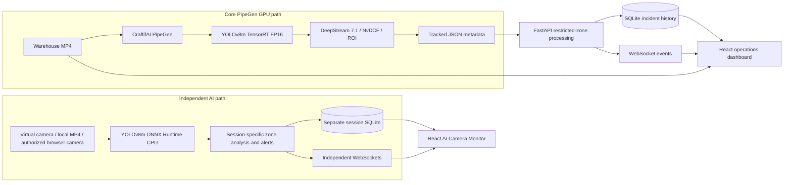

## Warehouse Demonstration

The Warehouse FP16 v2 execution processes genuine warehouse footage with person detection, multi-object tracking and restricted-zone evaluation. The operations dashboard replays that video in synchronization with its recorded DeepStream output, allowing operators to follow the detections and investigate safety events.

| Warehouse result | Value |
|---|---:|
| Processed video frames | **254** |
| Person observations across frames | **522** |
| Observed tracking IDs | **6** |
| Persisted restricted-zone entry incidents | **2** |
| Observed exits | **2** |
| Observed re-entries | **1** |

The two persisted entry incidents include the observed re-entry. Person observations are per-frame detections, rather than a count of unique workers; tracking IDs associate observations within the sequence. The editable restricted zone uses normalized image coordinates. With this moving-camera footage, it is a frame-relative demonstration region rather than a calibrated physical safety boundary. [Warehouse audit](evidence/final-product/warehouse-audit.json).

## Key Features

Eight application pages connect perception evidence to day-to-day incident operations:

| Page | Operator workflow |
|---|---|
| **Overview** | Warehouse video, person overlays, pipeline information and recent incidents in one safety workspace. |
| **Recorded Monitoring** | Synchronized PipeGen recording, bounding boxes, tracking IDs, restricted-zone overlay, playback and seeking. |
| **Incident Center** | Persistent history with severity, source and zone filters, event details, acknowledgment and JSON export. |
| **Zone Management** | Editable polygons, validation, confidence and severity settings, and application-managed zone rules. |
| **Analytics** | Incident trends, severity distribution, incidents by zone and review statistics. |
| **Model Performance** | TensorRT engine measurements, model provenance and independent CPU evidence. |
| **AI Camera Monitor** | Source selection, video/camera capture, CPU person inference and session-specific alerts. |
| **Integration** | FastAPI and WebSocket status, detection ingestion contracts and pipeline connectivity. |

## Independent AI Camera and Video Monitoring

The independent monitor extends the warehouse demonstration with a separate **YOLOv8m ONNX Runtime CPU** inference service and source-specific sessions:

- **Warehouse virtual camera:** captures actual prerecorded video pixels and runs fresh person inference.
- **Local MP4 analysis:** accepts a browser-selected video, sends sampled JPEG frames to the worker and displays returned person boxes against the corresponding processed frame. The selected MP4 remains in the browser.
- **USB/webcam interface:** implements device selection, browser permission handling, connect/disconnect, frame capture, start/stop, reconnection and media-track cleanup. Camera access requires localhost or HTTPS and explicit browser permission.
- **Session isolation:** maintains independent zone evaluation, alerts, SQLite storage and WebSocket state for additional sources.
- **Simulated USB harness:** exercises device selection, permission outcomes, disconnect/reconnect and cleanup while carrying genuine prerecorded pixels through the CPU inference worker. This is an automated camera-interface test, distinct from a physical webcam demonstration.
- **Deterministic safety simulation:** a nine-step fixture exercises outside-zone activity, entry, continued occupancy, exit, re-entry and deduplication. It produces **two entries, two exits and one re-entry**, with no repeated hold alerts. This simulation tests incident-processing logic separately from real video inference.

Virtual-camera and local-video workflows produced genuine person detections in browser acceptance. The original PipeGen GPU run uses the warehouse video-file source; browser camera frames use the independent CPU path. [Implementation and demonstrated workflows](docs/independent-ai-monitor.md) · [Acceptance evidence](evidence/final-product/matrix.md).

## Performance

| Engine metric | Measured or reported result |
|---|---:|
| Model | **YOLOv8m ONNX** |
| Runtime | **TensorRT 10.3.0 · FP16** |
| Compiled layers | **199** |
| GPU compute time | **5.28244 ms** |
| Engine execution latency | **6.19475 ms** |
| Reported engine throughput | **188.877 inferences/s** |
| Reported GPU-board power | **135.222 W** (66 samples; reported accuracy ±5 W) |
| FP16 engine size | **52,792,260 bytes** |

The 199 compiled layers comprise 185 FP16 and 14 FP32 layers. These are **engine-run benchmark measurements**, separate from full video-processing FPS and camera-to-alert latency. Power is the GPU-board reading reported through `nvidia-smi` during the engine run. The values are sourced from the [PipeGen warehouse engine report](evidence/04-tensorrt-fp16/warehouse-engine-summary.json).

## Application Screenshots

Eight integrated views cover the perception-to-decision workflow:

| Overview | Recorded Monitoring |
|---|---|
| 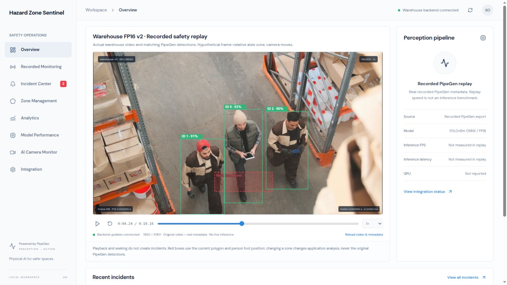 | 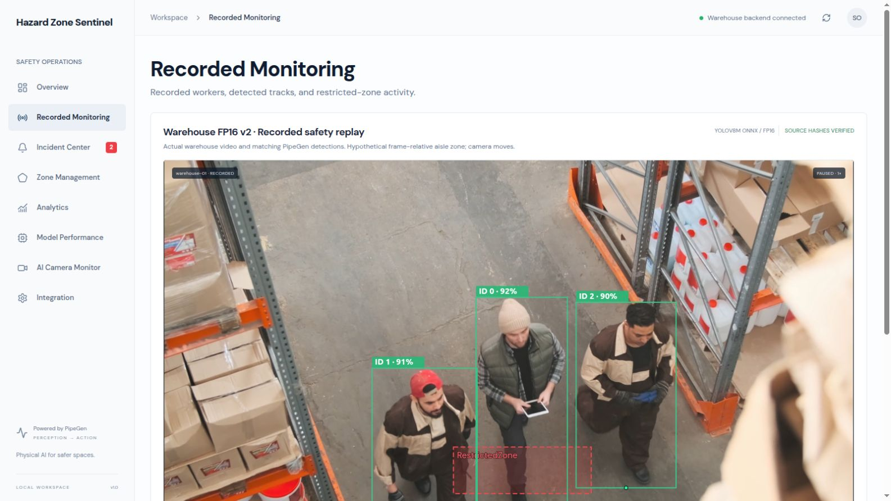 |

| Incident Center | Zone Management |
|---|---|
| 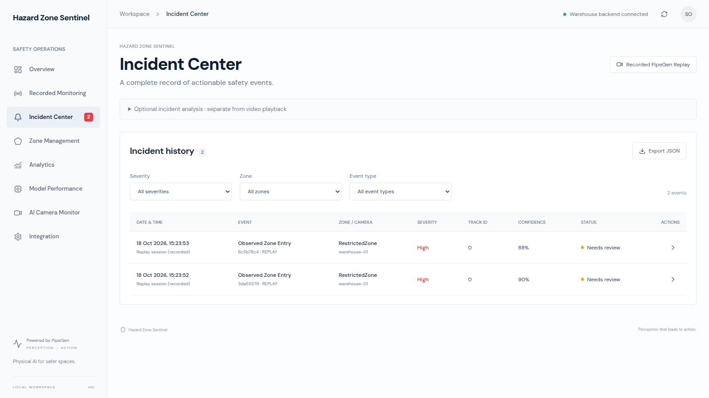 | 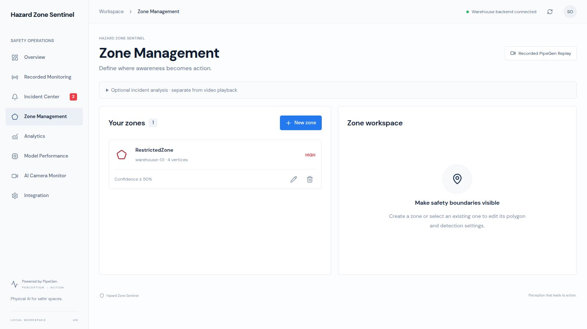 |

| Analytics | Model Performance |
|---|---|
| 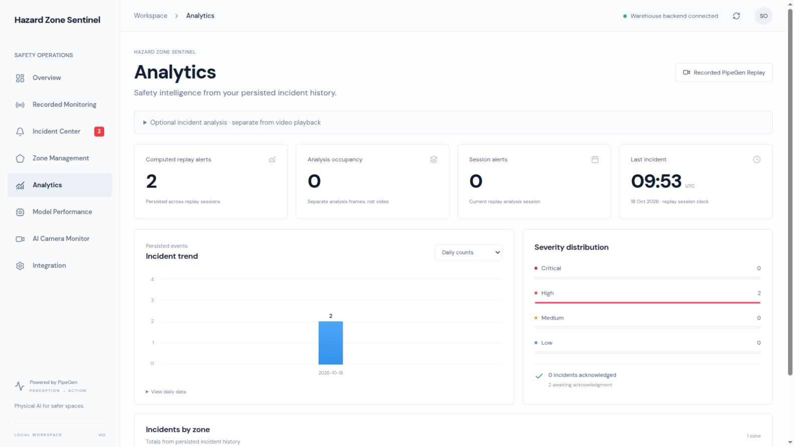 | 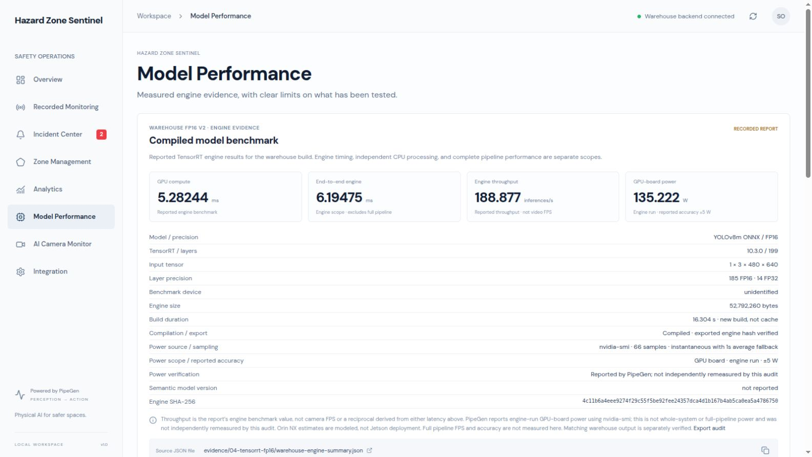 |

| AI Camera Monitor | Integration |
|---|---|
| 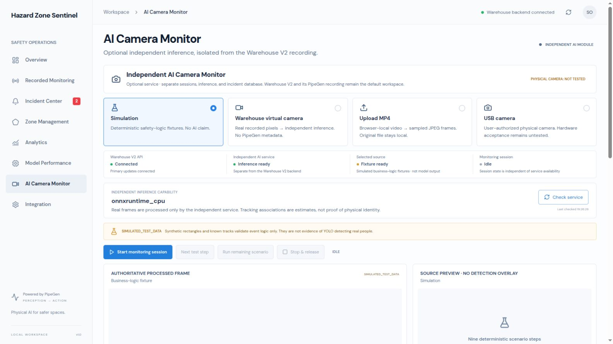 | 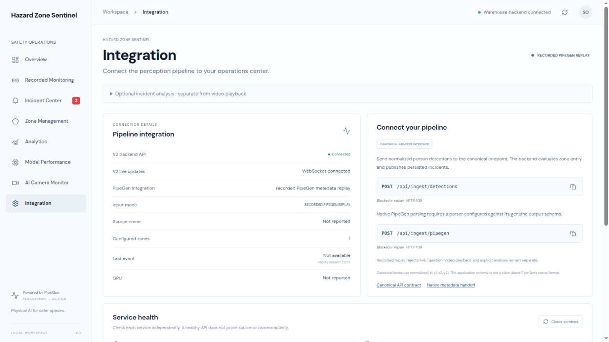 |

## Getting Started

Use **Python 3.12**, **Node.js 24** and **pnpm** for the tested application environment. The complete check script needs Node.js 22.18+ for native TypeScript tests. Running warehouse replay uses the saved metadata and does not require the GPU environment used to generate it.

Clone the repository, then install application dependencies:

```bash
git clone https://github.com/akilanpl/CraftifAIHackathon_CRA004.git
cd CraftifAIHackathon_CRA004
python3 -m venv .venv
.venv/bin/python -m pip install -r requirements-lock.txt
cd frontend
pnpm install --frozen-lockfile
cd ..
```

Prepare the external assets before launching:

- Obtain the matching warehouse MP4 described in the [warehouse profile](examples/warehouse-profile.json) and [warehouse release guide](docs/factory-release.md). The launcher verifies its pairing with the committed metadata.
- For independent inference, prepare `models/yolov8m.onnx`, the CPU dependencies (ONNX Runtime 1.31.0, NumPy 2.5.4 and Pillow 13.0.0) and writable `sessions/` under your chosen `SENTINEL_AI_HOME`. Follow the [independent AI setup guide](docs/independent-ai-monitor.md); its host setup script contains machine-specific storage checks and paths. The launch script uses `models/`, `dependencies/` and `sessions/` within that existing directory. Explicit `SENTINEL_AI_MODEL_PATH`, `SENTINEL_AI_DEPENDENCIES_PATH` and `SENTINEL_AI_DATA_DIR` overrides are also supported.

Launch the services from the repository root in **three separate terminals**:

**Terminal 1 — Warehouse V2 replay API (8003)**

```bash
./scripts/start-warehouse-demo.sh /absolute/path/to/warehouse-workers-4281405-1080p.mp4
```

**Terminal 2 — Independent AI monitor API (8005)**

```bash
SENTINEL_AI_HOME=/absolute/path/to/independent-ai-monitor \
AI_PORT=8005 ./scripts/start-ai-monitor.sh
```

**Terminal 3 — React dashboard (5173)**

```bash
SENTINEL_API_TARGET=http://127.0.0.1:8003 \
SENTINEL_AI_TARGET=http://127.0.0.1:8005 \
./scripts/start-frontend.sh --port 5173 --strictPort
```

Open [the dashboard](http://127.0.0.1:5173/). Play and seek the warehouse recording, inspect person boxes and tracking IDs, review incident history, then explore zone configuration, analytics and model evidence. In AI Camera Monitor, select the virtual camera or a local MP4, start monitoring and inspect the processed frames and session alerts.

The verified demonstration environment retains two warehouse incidents. A clean clone creates its own SQLite history; databases are excluded from Git. The local development camera harness is available at [the simulated-camera URL](http://127.0.0.1:5173/?cameraTest=1). `AI_PORT=8005` explicitly selects the documented demo port; the AI launcher's default is 8004.

More details: [Setup guide](docs/setup.md) · [AI Camera Monitor](docs/independent-ai-monitor.md) · [Canonical detection schema](docs/canonical-schema.md).

## Verification

The integrated release passed **239 backend tests**, **89 frontend tests**, TypeScript validation and a production build. Browser acceptance covered **all eight pages** at four viewport sizes, including video/metadata synchronization, incident review, zone editing, independent CPU inference, MP4 upload and simulated USB capture lifecycle.

```bash
bash scripts/check.sh
```

These are recorded release results. The real-worker HTTP/WebSocket checks require their opt-in model and frame configuration; see the [AI test setup](docs/independent-ai-monitor.md).

Evidence: [Executed test results](evidence/final-product/tests.txt) · [Browser acceptance matrix](evidence/final-product/matrix.md) · [Integrated release verification](evidence/final-product/postmerge-acceptance.json).

## Evidence and PipeGen Export

[Judge-facing submission package](submission/README.md) · [Reproducible Mac recorded-metadata integration check](submission/mac-validation.md).

The [Warehouse FP16 v2 PipeGen release](https://github.com/akilanpl/CraftifAIHackathon_CRA004/releases/tag/warehouse-fp16-v2-2026-10-18) distributes the original pipeline, model and engine artifacts separately from ordinary Git history in `pipegen-warehouse-hazard-sentinel-pipeline.tar.gz`. The archive is **134,818,189 bytes** with SHA-256 `5a2314ab3b97787ec699bb185b767bbf4ab70b7517433988d8e6d9e0c3aa4dec`.

- [Seven-node Pipeline IR](evidence/02-pipeline-ir/factory-PipelineIR.redacted.json)
- [TensorRT FP16 compiler and engine report](evidence/04-tensorrt-fp16/warehouse-engine-summary.json)
- [NVIDIA DeepStream execution audit](evidence/final-product/warehouse-audit.json)
- [Recorded frame-by-frame warehouse metadata](evidence/06-real-metadata/warehouse-fp16-v2-metadata.json)
- [Synchronized video/detection alignment](evidence/07-real-mode-dashboard/warehouse-browser-alignment.json)
- [Full export integrity record](evidence/factory-export-audit.json)

## Technology Stack

**Perception:** CraftifAI PipeGen, YOLOv8m ONNX, NVIDIA TensorRT FP16, NVIDIA DeepStream, NvDCF.

**Backend:** Python, FastAPI, WebSockets, SQLite, detection adapters and zone-event analysis.

**Frontend:** React, TypeScript and Vite, with video-synchronized overlays and interactive operational analytics.

**Independent video inference:** ONNX Runtime CPU, browser camera/media APIs and source-isolated AI sessions.

## Media Attribution

Warehouse source footage: [*Men Working in a Warehouse*](https://www.pexels.com/video/men-working-in-a-warehouse-4281405/) by Tiger Lily, sourced from Pexels under the [Pexels License](https://www.pexels.com/license/). Historical street footage: [*Busy City Intersection with Pedestrians and Traffic*](https://www.pexels.com/video/busy-city-intersection-with-pedestrians-and-traffic-36306747/) by Nothing Ahead / Pexels, also under the Pexels License. [Media provenance](demo-video/README.md).
