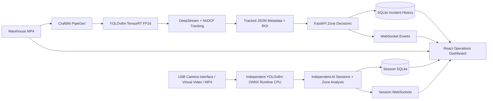

# Hazard Zone Sentinel

**A GPU-accelerated workplace safety perception system built with CraftifAI PipeGen, NVIDIA TensorRT, DeepStream, FastAPI and React.**

Hazard Zone Sentinel transforms warehouse video into actionable safety intelligence. It detects and tracks workers, evaluates restricted-zone activity and delivers structured incidents to an operations dashboard for review, acknowledgment and analysis.

Built for **Track A — PipeGen (Perception)** of the **Embedded SF: CraftifAI Physical AI Hackathon**, the project brings together a complete PipeGen pipeline, a compiled TensorRT engine, an NVIDIA DeepStream execution and downstream safety operations. It also includes an independent AI Camera Monitor for browser-connected cameras and new video sources.

## Track A — From Requirement to Action

The complete perception workflow is central to the application, from the original vision requirement through to the incident records shown to operators.

| Track A deliverable | Hazard Zone Sentinel implementation |
|---|---|
| **Requirement → Pipeline IR → Model → Compiler → Run** | Built and executed a seven-node PipeGen warehouse pipeline: video input, preprocessing, YOLOv8m detection, person postprocessing, NvDCF tracking, restricted-zone analytics and JSON export. |
| **TensorRT engine and speed report** | Compiled YOLOv8m ONNX using TensorRT 10.3.0 with FP16 precision; retained the engine benchmark and compiler evidence. |
| **NVIDIA GPU pipeline execution** | Ran the generated DeepStream pipeline on warehouse video, producing genuine frame-timestamped person detections, tracking IDs and ROI metadata. Video-file input is a supported Track A live-run source. |
| **Actionable output** | Connected JSON detection output to polygon-based entry/exit decisions, a FastAPI backend, SQLite incident history, WebSocket updates, analytics, acknowledgments and JSON export. |

The original [Pipeline IR](evidence/02-pipeline-ir/factory-PipelineIR.redacted.json), [warehouse engine report](evidence/04-tensorrt-fp16/warehouse-engine-summary.json), [DeepStream execution evidence](evidence/final-product/warehouse-audit.json) and [full PipeGen export](https://github.com/akilanpl/CraftifAIHackathon_CRA004/releases/tag/warehouse-fp16-v2-2026-10-18) document the core pipeline.

## Original PipeGen Pipeline Evidence

The following are screenshots captured from the original **Hazard Zone Sentinel — Warehouse FP16 v2** project in CraftifAI PipeGen v0.5.1. They document the actual Pipeline IR, TensorRT compiler benchmark, and completed DeepStream pipeline run. Select an image to open the original full-screen capture.

### 1. Pipeline IR — seven-node graph

[](evidence/pipegen-gui/warehouse-ir-graph-original.png)

The seven nodes connect **warehouse video → preprocessing → YOLOv8m inference → postprocessing → NvDCF tracking → restricted-zone analytics → JSON output**. The [saved Pipeline IR](evidence/02-pipeline-ir/factory-PipelineIR.redacted.json) preserves its configuration.

### 2. TensorRT FP16 model speed report

[](evidence/pipegen-gui/warehouse-fp16-benchmark-original.png)

PipeGen's on-screen benchmark presents approximately **6.195 ms per engine execution** and **135.2 W GPU-board power**. The [engine report JSON](evidence/04-tensorrt-fp16/warehouse-engine-summary.json) separately records **188.877 engine inferences/s**; both figures refer to engine benchmarks rather than full video-pipeline FPS.

### 3. DeepStream pipeline run and export

[](evidence/pipegen-gui/warehouse-deepstream-run-original.png)

The original PipeGen run reports **254 processed frames in 10.12 seconds** and **573 detected objects** across classes. The [warehouse metadata audit](evidence/final-product/warehouse-audit.json) identifies **522 person observations** in the corresponding detection output, along with six tracker IDs. The [exported pipeline archive](https://github.com/akilanpl/CraftifAIHackathon_CRA004/releases/tag/warehouse-fp16-v2-2026-10-18) preserves the model, engine, and generated pipeline files.

## The Warehouse Safety Demonstration

The Warehouse FP16 v2 execution processes genuine warehouse footage with person detection, multi-object tracking and restricted-zone evaluation. The operations dashboard replays that video in synchronization with its recorded DeepStream output, allowing operators to follow the detections and investigate safety events.

| Warehouse result | Value |
|---|---:|
| Processed video frames | **254** |
| Person observations across frames | **522** |
| Observed tracking IDs | **6** |
| Persisted restricted-zone entry incidents | **2** |
| Observed exits | **2** |
| Observed re-entries | **1** |

The red restricted zone is an editable, normalized image-space polygon. Person observations represent detections across frames; tracking IDs link observations during the recorded sequence.

### TensorRT FP16 performance

| Engine metric | Measured or reported result |
|---|---:|
| Model | **YOLOv8m ONNX** |
| Runtime | **TensorRT 10.3.0 · FP16** |
| Compiled layers | **199** |
| GPU compute time | **5.28244 ms** |
| End-to-end engine time | **6.19475 ms** |
| Reported engine throughput | **188.877 inferences/s** |
| Reported GPU-board power | **135.222 W** |
| FP16 engine size | **52,792,260 bytes** |

These are **engine-run benchmark measurements**, separate from recorded-video playback and end-user dashboard responsiveness. The values are sourced from the [PipeGen warehouse engine report](evidence/04-tensorrt-fp16/warehouse-engine-summary.json).

## Capabilities

### 1. Recorded workplace monitoring

Synchronized warehouse footage with person bounding boxes, detection confidence, NvDCF track IDs and a clearly marked restricted zone. Playback, pause and seeking allow incident context to be reviewed frame by frame.

### 2. Restricted-zone intelligence

Editable polygon zones with confidence and severity settings. The event engine evaluates entry, occupancy, exit and re-entry using tracked detections and maintains a consistent distinction between playback and persisted analysis.

### 3. Incident operations and safety analytics

A FastAPI and SQLite incident workflow with severity, source and event filters; incident details; persistent acknowledgment state; and JSON export. Analytics visualize incident trends, zone distributions, severity and review status.

### 4. USB camera and independent AI monitor

A separate camera-monitoring workspace implements:

- **USB/webcam connection controls:** browser camera selection, permission flow, connect/disconnect, start/stop monitoring and media-track cleanup.
- **Virtual warehouse camera:** prerecorded video streamed as camera-like frames through a genuine YOLOv8m ONNX Runtime CPU worker.
- **Local MP4 analysis:** browser-selected videos processed through the same independent detection and zone-event pipeline.
- **Frame-accurate results:** processed-frame preview with genuine person detections, confidence, timestamps and source-specific session data.
- **Isolated monitoring sessions:** separate API, WebSocket updates and SQLite storage for camera/video analysis.
- **Camera workflow demonstration:** simulated USB capture carrying actual prerecorded pixels through the real CPU inference worker, with device selection, permission and reconnection scenarios.

The independent CPU processing audit recorded a **629.744 ms median per sampled frame** across 41 warehouse frames. This is a separate measurement from the PipeGen GPU engine benchmark. [AI camera implementation](docs/independent-ai-monitor.md).

### 5. Safety-scenario simulation

A deterministic nine-step demonstration exercises restricted-zone logic from approach and entry through exit and re-entry. The verified scenario produced **two entries, two exits and one re-entry**, with synthetic scenario data clearly identified in the interface.

### 6. Operations integration

The Integration page surfaces FastAPI availability, WebSocket connectivity, ingestion routes and source status. The backend exposes canonical person-detection ingestion and a native PipeGen metadata adapter for downstream safety workflows.

## System Architecture



The PipeGen/DeepStream workflow supplies the core warehouse perception evidence. The separate ONNX Runtime service enables additional camera and video analysis while keeping session data independent.

## The Dashboard

Eight integrated views cover the perception-to-decision workflow:

| Overview | Recorded Monitoring |
|---|---|
|  |  |

| Incident Center | Zone Management |
|---|---|
|  |  |

| Analytics | Model Performance |
|---|---|
|  |  |

| AI Camera Monitor | Integration |
|---|---|
|  |  |

## Run the Demonstration

The tested application uses Python 3.12, Node.js 24, React/Vite and FastAPI. The independent AI worker uses ONNX Runtime CPU 1.31.0. The matching warehouse source video and AI model/runtime assets are kept outside ordinary Git history.

Install application dependencies from the repository root:

```bash
python3 -m venv .venv
.venv/bin/python -m pip install -r requirements-lock.txt
cd frontend
pnpm install --frozen-lockfile
cd ..
```

Launch the services in separate terminals:

**Warehouse V2 replay API**

```bash
./scripts/start-warehouse-demo.sh /absolute/path/to/warehouse-workers-4281405-1080p.mp4
```

**Independent AI monitor API**

```bash
SENTINEL_AI_HOME=/absolute/path/to/independent-ai-monitor \
AI_PORT=8005 ./scripts/start-ai-monitor.sh
```

**React dashboard**

```bash
SENTINEL_API_TARGET=http://127.0.0.1:8003 \
SENTINEL_AI_TARGET=http://127.0.0.1:8005 \
./scripts/start-frontend.sh --port 5173 --strictPort
```

Open **http://127.0.0.1:5173/**. Explore Recorded Monitoring, the two persisted warehouse incidents, model performance, zone management and the independent AI Camera Monitor. The local simulated-camera demonstration is available with the `?cameraTest=1` query parameter.

More details: [Setup guide](docs/setup.md) · [AI Camera Monitor](docs/independent-ai-monitor.md) · [Canonical detection schema](docs/canonical-schema.md).

## Verification

The integrated release passed **239 backend tests**, **89 frontend tests**, TypeScript validation and a production build. Browser acceptance covered **all eight pages** at four viewport sizes, including video/metadata synchronization, incident review, zone editing, independent CPU inference, MP4 upload and simulated USB capture lifecycle.

```bash
bash scripts/check.sh
```

Evidence: [Executed test results](evidence/final-product/tests.txt) · [Browser acceptance matrix](evidence/final-product/matrix.md) · [Integrated release verification](evidence/final-product/postmerge-acceptance.json).

## PipeGen Export and Reproducibility

The [Warehouse FP16 v2 PipeGen release](https://github.com/akilanpl/CraftifAIHackathon_CRA004/releases/tag/warehouse-fp16-v2-2026-10-18) includes the exported pipeline archive and model artifacts. The archive is **134,818,189 bytes** with SHA-256 `5a2314ab3b97787ec699bb185b767bbf4ab70b7517433988d8e6d9e0c3aa4dec`.

- [Seven-node Pipeline IR](evidence/02-pipeline-ir/factory-PipelineIR.redacted.json)
- [TensorRT FP16 compiler and engine report](evidence/04-tensorrt-fp16/warehouse-engine-summary.json)
- [NVIDIA DeepStream execution audit](evidence/final-product/warehouse-audit.json)
- [Recorded frame-by-frame warehouse metadata](evidence/06-real-metadata/warehouse-fp16-v2-metadata.json)
- [Synchronized video/detection alignment](evidence/07-real-mode-dashboard/warehouse-browser-alignment.json)
- [Full export integrity record](evidence/factory-export-audit.json)

## Technology Stack

**Perception:** CraftifAI PipeGen, YOLOv8m ONNX, NVIDIA TensorRT FP16, NVIDIA DeepStream, NvDCF.

**Backend:** Python, FastAPI, WebSockets, SQLite, detection adapters and zone-event analysis.

**Frontend:** React, TypeScript and Vite, with video-synchronized overlays and interactive operational analytics.

**Independent video inference:** ONNX Runtime CPU, browser camera/media APIs and source-isolated AI sessions.

## Media Credits

Warehouse source footage: [*Men Working in a Warehouse*](https://www.pexels.com/video/men-working-in-a-warehouse-4281405/) by Tiger Lily, sourced from Pexels under the [Pexels License](https://www.pexels.com/license/). [Additional source provenance](demo-video/README.md).
