# Architecture

Hazard Zone Sentinel converts tracked person metadata into actionable, persisted safety incidents. CraftifAI PipeGen is the required vision system; this repository provides the application and integration boundary.

```text
Camera / video
  → CraftifAI PipeGen: Requirement → Pipeline IR → Model → Compiler → Run
  → ONNX → actual TensorRT FP16 engine → DeepStream person tracking
  → genuine metadata (format pending observation)
  → backend/adapters/pipegen_adapter.py (native parser is intentionally unconfigured)
  → canonical detections or native zone-entry events
  → zone-entry engine
  → SQLite + optional JSONL → REST / WebSocket → React dashboard
```

The Python process owns mutable track state and SQLite writes. Run one Uvicorn worker: multiple workers would hold independent entry states and WebSocket clients. The Vite development server proxies backend API and WebSocket requests. The dashboard renders normalized detection metadata unless an actual video URL is supplied; boxes are not evidence of camera inference.

An entry uses the bottom-center of normalized `[x1,y1,x2,y2]` boxes as approximate feet. Geometry uses normalized 0–1 zone vertices. State is isolated by camera, zone and reported track ID. Stable occupancy emits one entry, then exit permits a new incident on re-entry. Missing IDs are excluded from tracked entry generation; no inferred identity is invented. Stale state expiry can treat a later return as a fresh entry; consult the engine settings and tests for the exact interval. Person confidence filtering excludes weak observations. Native analytics use external event identifiers persisted in SQLite for deduplication. Native batches bypass detection processing. Keep one authoritative mode for each camera/zone. A matching tracked person already inside is suppressed across native/derived modes; untracked native events cannot be correlated to geometry state.

Production starts disconnected with no fabricated incidents or telemetry. Synthetic mode uses a separate SQLite path and explicit provenance. API connection, metadata receipt and actual PipeGen integration are separate facts. Receiving canonical JSON does not demonstrate a working PipeGen pipeline.

## Deployment boundary

This hackathon prototype binds localhost. It has no authentication, access roles or TLS. Keep it local or add an authenticated gateway before sharing across a network. Retain actual source timestamps and stable tracking IDs when adapting metadata. Do not publish camera imagery without permission.

## System diagram and evidence boundary

```mermaid
flowchart LR
    Camera["Real camera / video"] --> Requirement["PipeGen Requirement · PENDING"]
    Requirement --> IR["Actual Pipeline IR · PENDING"]
    IR --> Model["Selected model + version · PENDING"]
    Model --> Compiler["TensorRT FP16 + actual report · PENDING"]
    Compiler --> Run["GPU DeepStream execution · PENDING"]
    Run --> Metadata["Genuine metadata · PENDING"]
    Metadata --> Adapter["Native metadata parser · PENDING"]
    Adapter --> Engine["Validated zone-entry engine"]
    Engine --> SQLite["SQLite + optional JSONL"]
    SQLite --> API["FastAPI REST + WebSocket"]
    API --> UI["React dashboard"]
    UI --> Evidence["Real-mode dashboard evidence · PENDING"]
    Synthetic["Explicit synthetic test input"] -. "separate synthetic database" .-> Engine
```



Solid flow describes the intended genuine integration. The synthetic branch verifies application behavior only. Real-mode dashboard evidence requires genuine source data and the actual PipeGen run; the implemented UI alone cannot satisfy that stage.
